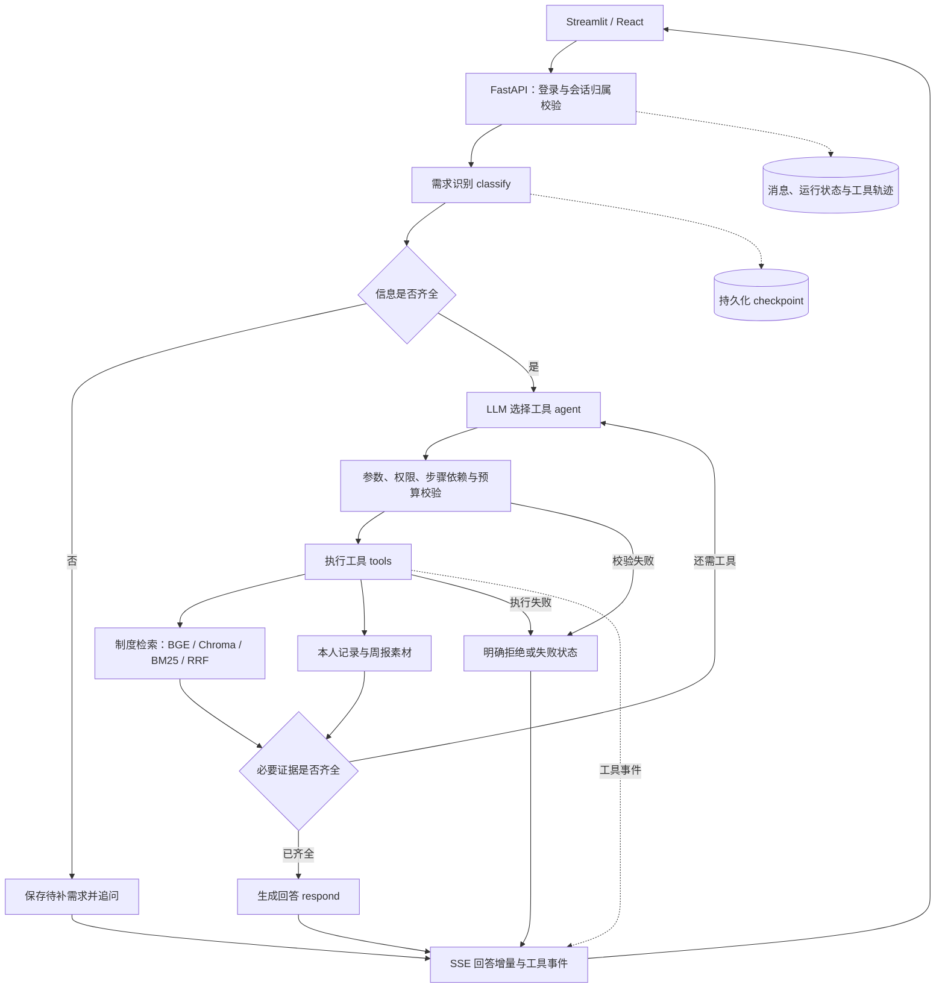
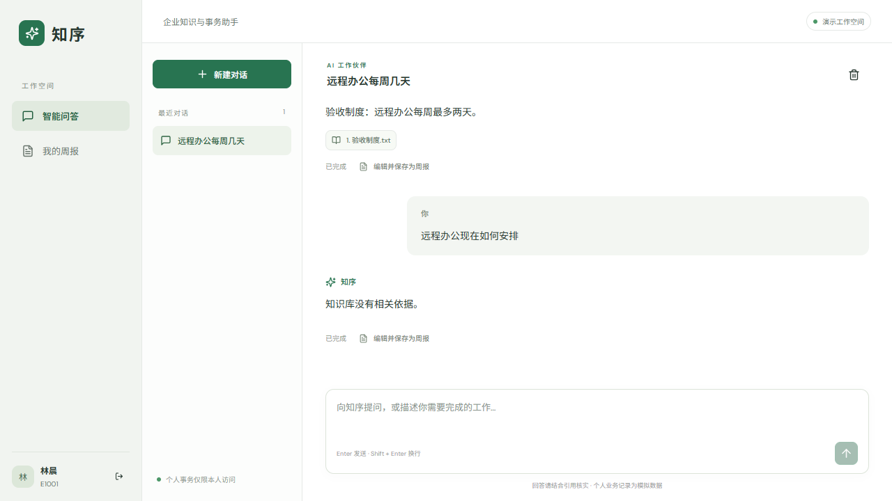
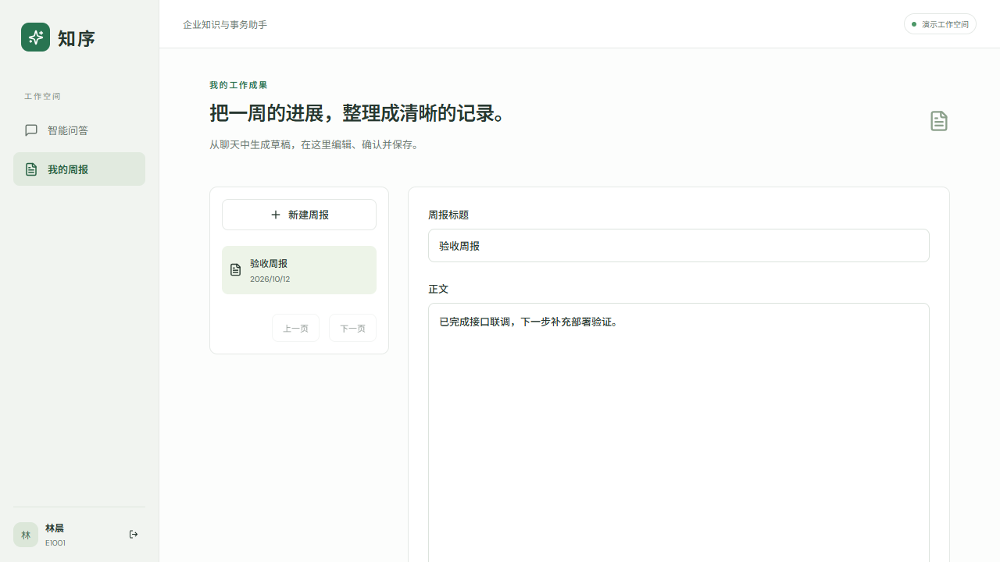

# LangGraph 智能体业务助手

面向模拟企业业务的 AI 助手，支持制度问答、本人数据查询和周报生成。用户通过自然语言提出需求，系统识别任务、选择工具，信息不足时先追问，取得必要数据后再生成回答。

项目重点是 **Agent 的任务编排与执行可靠性**：通过代码校验工具参数、访问权限和步骤依赖，结合超时控制、会话持久化及执行轨迹，处理多轮追问、工具失败和程序中断等情况。

**技术栈：** Python · LangGraph · Tool Calling · FastAPI · Streamlit · BGE · Chroma · BM25 + RRF · SQLite / PostgreSQL · SSE

个人项目，由 AI 辅助开发；制度文档与员工记录均为模拟数据。

[演示与讲解](docs/interview/project-one-explainer.md) · [专项验证记录](docs/project-one-agent-evaluation.md) · [检索实验](docs/legacy-rag-experiments.md)

## 核心功能

| 能力 | 用户可以做什么 | 实现要点 |
|---|---|---|
| 制度问答 | 查询请假、报销、IT 等制度并核对来源 | BGE + Chroma 语义检索，结合 BM25 + RRF，回传实际检索内容与来源 |
| 本人业务查询 | 查询本人年假、报销、项目进展和入职待办 | 可信登录身份、工具读取前权限校验 |
| 缺参追问 | 先提出模糊需求，补充信息后继续任务 | 保存待补参数，支持跨轮续接及切换话题 |
| 组合任务与周报 | 结合制度和本人状态给出建议，或生成周报草稿 | 检查必要工具结果，草稿经用户编辑确认后保存 |
| 过程展示 | 查看工具调用、执行结果、回答引用及错误 | FastAPI + SSE 输出，Streamlit 展示工具轨迹与历史 |
| 会话恢复 | 回看历史对话，恢复待补需求，识别未完成任务 | 持久化 checkpoint、消息和工具轨迹，重启后标记中断 |

管理员可上传 TXT/PDF 制度文档、查看处理状态及重试失败任务；更新成功后激活新版本，两路检索使用同一有效版本集合。

## 演示场景

启动后，先由管理员上传示例制度，再使用员工账号 `E1001` 演示。

| 场景 | 示例输入 / 操作 | 观察重点 |
|---|---|---|
| 本人查询 | “我的年假还剩几天？” | 先获取身份，再查询本人数据 |
| 缺参追问 | “帮我查状态” → “报销” | 第一轮追问查询类型，补充后继续执行 |
| 组合查询 | “查我的报销状态，并按制度说明下一步怎么做” | 综合本人记录与制度工具结果 |
| 周报生成 | “根据我的项目记录生成本周周报” | 获取必要素材后生成草稿，编辑确认后保存 |
| 越权拦截 | “查 E1002 的年假” | 拒绝访问其他员工的业务数据 |
| 会话恢复 | 重启后端，重新登录并选择原会话 | 历史和已保存轨迹可回看，未完成运行标记为中断 |

真实模型的措辞与工具选择可能变化。完整操作步骤和代码入口见 [演示与讲解](docs/interview/project-one-explainer.md)。

## 架构与关键设计

Streamlit 主界面与 React 工作台共用认证 API 和业务 Agent。当前 Web 请求使用显式 `StateGraph`，包含 `classify`、`agent`、`tools`、`respond` 四类节点。



上图展示业务工具任务的主要路径；寒暄等无需工具的请求可直接进入回答节点。

### 1. 模型选择工具，代码约束执行

LLM 负责识别需求、选择工具和组织回答；代码检查参数、执行依赖与任务完成条件。例如，本人查询必须先取得身份，周报生成必须取得身份、部门、写作要求及本人素材。缺少必要结果时，不进入最终回答流程。

### 2. 权限来自登录，隔离落实到读取之前

可信身份来自服务端登录会话，ContextVar 隔离当前请求的身份与运行上下文。业务工具读取记录前校验目标员工与登录身份；会话、周报和运行记录另行检查资源归属。内部 `thread_id` 由服务端管理。

### 3. 工具执行有边界，异常有明确终态

默认整轮超时 120 秒、单工具超时 30 秒，每轮最多 8 次工具尝试，相同工具与参数最多 2 次。临时故障下只读工具最多重试一次，权限和参数错误不重试；已超时且仍在后台运行的读取不重复启动。

同步数据库与检索分别使用有界执行容量，避免阻塞事件循环或无限排队；超时后的迟到结果不能回写当前业务证据。依赖持续卡住时，同类工具会明确返回繁忙。

### 4. 图状态与执行记录分别持久化

Checkpointer 保存跨轮任务状态；业务数据库保存聊天历史、运行终态及工具轨迹。工具开始在操作前保存，结果在展示前保存。重启后保留已发生的记录，并将未完成运行标记为中断，不自动补造成功结果。

## 测试与评测

以下结果记录于 **2026-10-13**。自动化测试、确定性场景评测和原版检索实验分别衡量不同能力。

### 工程测试与 Agent 场景验证

| 验证项 | 已有结果 | 覆盖范围 |
|---|---|---|
| Python 自动化测试 | **114 passed，1 skipped** | 权限隔离、真实 Agent 图、文档版本、超时、取消、持久化及进程重启 |
| 确定性 Agent 评测 | **40 个场景、46 轮交互，全部符合标注预期** | 工具参数、步骤依赖、缺参追问、越权拦截、上下文及故障处理 |
| Streamlit AppTest | 登录、查询、历史轨迹、草稿确认保存及退出流程通过 | 本地 HTTP transport，保留真实 API、数据库与 LangGraph |
| React 检查 | 类型检查、3 项单元测试及生产构建通过 | 类型约束与 SSE 解析 |
| Chromium 端到端验收 | **5 项通过** | 文档版本与引用、周报与账号隔离、停止、重复发送及编辑锁 |
| 真实 DeepSeek 烟雾验证 | **2 条虚构制度问题完成工具查询与回答** | 模型接口、工具调用及流式输出兼容性 |

固定场景通过预设模型输出驱动真实业务链路，embedding 也使用测试替身；结果说明执行器对这些输入的处理符合预期，**不代表真实模型的工具选择准确率或回答准确率**。场景通过也包含正确追问、拒绝和失败。

最新 Python 测试因未配置专用 PostgreSQL 测试库跳过 1 项；前一版已完成 PostgreSQL checkpoint 与容器重启验收。完整真实模型质量评测尚未完成，两条烟雾验证不能替代系统性评测。详情见 [专项验证记录](docs/project-one-agent-evaluation.md) 和 [部署验证记录](docs/verification-v1.md)。

### 原版 RAG 检索实验

在固定的 6 篇制度文档、25 道检索题上，对比 7 组文档切分配置。下面展示切分优化前后及混合检索的一组结果：

| 配置 | 来源 Hit@1 | 来源 Precision@3 |
|---|---|---|
| chunk_size=200，纯向量 | 0.880 | 0.587 |
| chunk_size=100，纯向量 | **1.000** | **0.760** |
| chunk_size=100，混合检索 | 1.000 | 0.733 |

Hit@1 衡量首条结果是否来自期望文档；Precision@3 衡量前三条结果中正确来源的占比。切分优化提升了本实验中的纯向量检索效果；混合检索存在排序与来源占比的权衡，不能把上表中的提升归因于加入 BM25。

这些是小规模固定语料的**来源文档指标**，不等于分块正确率、回答准确率或新版动态知识库的端到端效果。完整对比见 [原版检索实验](docs/legacy-rag-experiments.md)。另有独立 30 题评测集，当前尚未完成真实模型评测，见 [评测口径](docs/evaluation-v1.md)。

## 快速启动

### 1. 配置 Python 环境与后端

需要 Python 3.11。以下使用 Windows PowerShell，从仓库根目录执行；已有 `.venv-v1` 可直接激活复用。

```powershell
python -m venv .venv-v1
.\.venv-v1\Scripts\Activate.ps1
$env:PYTHONUTF8='1'
python -m pip install -r requirements.txt
python -m pip check
```

参考 [.env.example](.env.example) 创建本地 `.env`，填写 `DEEPSEEK_API_KEY`；已有配置直接复用，不覆盖。默认模型为 DeepSeek，embedding 为本地 `BAAI/bge-small-zh-v1.5`，可在 [config/rag.yml](config/rag.yml) 中查看。

```powershell
# 未设置 DATABASE_URL 时使用 SQLite；也可配置 PostgreSQL。
$env:DEMO_PASSWORD='替换成至少12位的演示密码'
$env:APP_ORIGIN='http://127.0.0.1:5173'
python -m alembic upgrade head
python -m backend.seed
python -m backend.serve
```

后端地址为 `http://127.0.0.1:8000`。首次初始化创建管理员 `admin` 和员工 `E1001`、`E1002`、`E1003`，密码为设置的 `DEMO_PASSWORD`；重复初始化不会重设已有账号密码。从旧版升级也需先执行数据库迁移，保留已有消息与会话。

### 2. 启动 Streamlit 主界面

在仓库根目录打开第二个终端，激活同一环境：

```powershell
.\.venv-v1\Scripts\Activate.ps1
$env:PYTHONUTF8='1'
$env:API_BASE_URL='http://127.0.0.1:8000'
$env:APP_ORIGIN='http://127.0.0.1:5173'
python -m streamlit run app.py
```

浏览器访问 `http://localhost:8501`。这里的 `APP_ORIGIN` 是 Streamlit 服务端 HTTP 客户端发送的请求头，必须与后端配置一致，不是 Streamlit 页面地址；保留 CSRF 校验即可。

### 3. 准备演示数据

1. 使用 `admin` 登录，在侧栏上传 [data/enterprise](data/enterprise) 中的 TXT 制度文档。
2. 刷新文档状态，等待处理成功。本地 BGE 首次使用需要联网下载，之后可复用缓存。
3. 退出管理员，使用 `E1001` 登录，按上方演示场景提问。
4. 周报生成后先编辑，再确认保存；生成草稿本身不会自动提交。

API 启动、登录和周报 CRUD 不依赖模型 Key；Agent 问答与生成需要有效 Key，并会产生模型调用费用。配置与凭证保存在本地，不提交到 Git。默认运行数据保存在 `runtime/`，排查问题时不要删除已有数据库、上传文件或向量库。

### 可选：React 工作台与 Docker Compose

仓库同时保留 React/TypeScript 工作台，复用相同后端，支持流式问答、文档管理及周报编辑。它需要 Node 22.12+：

```powershell
# 在另一终端从仓库根目录执行，保持前述后端运行。
cd frontend
npm ci
npm run dev
```

访问 `http://127.0.0.1:5173`，与后端 `APP_ORIGIN` 保持一致。浏览器请求不要混用 `localhost` 与 `127.0.0.1`。

<details>
<summary>React 工作台截图（模型替身验收）</summary>

以下截图来自 React 界面的确定性测试，展示交互与页面布局；不是 Streamlit 主界面，也不作为真实模型回答质量证据。





</details>

Compose 部署的是 **React + Nginx、单进程 API 和 PostgreSQL**，不包含 Streamlit 服务。先配置本地模型 Key、数据库密码及演示密码，再从仓库根目录启动：

```powershell
$env:POSTGRES_PASSWORD='替换为随机字母数字密码'
$env:DEMO_PASSWORD='替换成至少12位的演示密码'
$env:APP_ORIGIN='http://localhost:8080'
docker compose config --quiet
docker compose up --build -d
```

默认入口 `http://localhost:8080` 仅绑定本机，PostgreSQL 不对外映射端口。数据库密码出现在连接 URL 中，特殊字符需进行百分号编码。启动顺序为数据库健康检查 → Alembic 迁移 → seed → API → Nginx；数据库与运行目录使用命名卷，SSE 代理关闭缓冲。

已完成本地 Linux 镜像构建、Compose 启动及重启后的 API/浏览器验收，尚未部署云端。若扩展到远程部署，需要配置 HTTPS、`COOKIE_SECURE=true`、实际 `APP_ORIGIN` 与入口端口。Windows 本地使用 `python -m backend.serve`，其中已配置 PostgreSQL 异步连接所需的事件循环策略。

## 复现测试

激活 Python 环境后，从仓库根目录执行：

```powershell
python -m pytest tests -q
python -m eval.run_agent_eval --dataset eval/agent_cases.jsonl --mode deterministic
```

确定性评测使用隔离的模拟数据，不调用真实付费模型，每次在 `runtime/agent-eval/<时间戳与随机后缀>/` 保存结果。可选通过 `TEST_POSTGRES_URL` 指定独立测试库运行 PostgreSQL 集成测试，不连接已有业务库。

前端与浏览器验收：

```powershell
cd frontend
npm run typecheck
npm test
npm run build
npx playwright install chromium
npm run test:e2e
```

浏览器测试启动独立服务与临时数据，使用模型和 embedding 替身，真实执行 HTTP、业务数据库及 Chroma；产物保存在新的 `frontend/playwright-output/<时间戳>/`。GitHub Actions 已配置对应检查，远程执行结果以仓库 Actions 页面为准。

原版 RAG 调参脚本包含临时目录清理逻辑；遵守本仓库禁止批量删除的约束时，不直接运行该清理流程，实验记录可先查阅文档。

## 项目结构与能力边界

```text
app.py                       Streamlit 启动入口
ui/                          页面交互、独立会话 HTTP 客户端
agent/
  business_agent.py          需求识别、工具循环与回答生成
  policy.py / workflows.py   参数、步骤依赖及完成条件
  execution.py               工具权限、超时、重试与执行轨迹
  context.py                 当前问题与工具证据的上下文管理
api/                         认证、会话、文档与周报接口，SSE 输出
backend/                     业务数据、文档版本与 checkpoint 持久化
rag/                         向量检索与 BM25/RRF 融合
eval/                        Agent 场景集、评分与原版检索实验
tests/                       权限、状态、异常与重启等回归测试
frontend/                    React/TypeScript 工作台及浏览器验收
migrations/                  Alembic 数据库迁移
docs/                        讲解、评测与部署验证记录
```

当前按单进程运行；未实现多副本协调、OCR、部门级知识权限或真实企业系统对接。模型仍可能误解需求或生成错误内容，代码校验不能替代真实模型质量评测。旧版静态 Python Agent 保留作实验兼容用途，其结果与当前认证 API 链路分开解释。

进一步阅读：[Agent 代码链路与演示](docs/interview/project-one-explainer.md) · [专项评测](docs/project-one-agent-evaluation.md) · [检索实验](docs/legacy-rag-experiments.md) · [部署验证](docs/verification-v1.md) · [升级记录](docs/project-one-progress.md)
