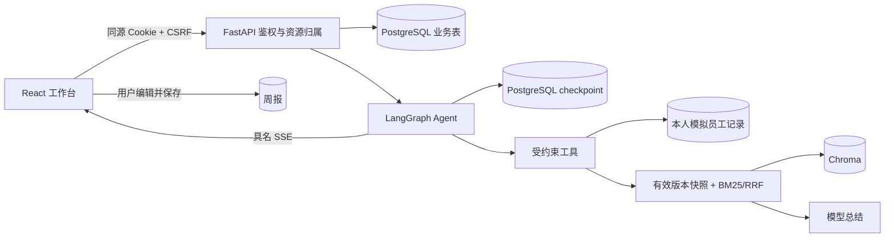

# 架构讲解

> 当前项目一使用 Streamlit 与显式业务图，优先阅读 [项目一讲解](project-one-explainer.md)。下文保留此前 React 全栈版本的架构资料，不作为本轮新增能力的完整说明。

## 一分钟介绍

这是我用 AI 辅助实现的个人项目：企业知识与事务助手。前端使用 React 和 TypeScript，后端使用 FastAPI，AI 编排使用 LangGraph。员工可以登录、查询知识库和本人模拟业务数据，把生成的周报编辑保存；管理员可以上传、更新、停用知识文档。业务数据库与 Agent checkpoint 使用 PostgreSQL，向量保存在 Chroma。

我重点解决了三个问题：服务端身份与资源隔离、流式生成的取消和持久化、文档更新后的版本一致性。测试将模型替换为确定性响应，同时保留真实数据库、Agent 图和向量库来验证工程行为。真实模型效果与流程测试分开记录，当前没有真实模型准确率或并发规模结论。

## 请求链路

五分钟讲解顺序：先演示用户操作，再解释登录会话和资源所有权，然后跟随一次 SSE 到 LangGraph 工具，最后解释文档版本与数据库。不要先背依赖包列表。

## 数据职责

`users → auth_sessions` 表示登录凭证的归属；`users → conversations → messages/chat_runs` 表示展示历史与生成状态；`users → weekly_reports` 表示已确认的工作成果。`documents → document_versions` 保存文件状态与有效版本指针。`employee_records` 保存模拟业务记录。checkpoint 表由扩展管理，它保存图执行状态，业务消息表保存面向用户的历史；两者不能互相替代。

第一版为单进程：取消事件与上传处理器位于进程内，业务锁也在进程内。多副本前需要共享运行控制、任务队列和分布式互斥。此版本没有部门级知识 ACL、OCR、复杂工作流和生产高可用能力。
