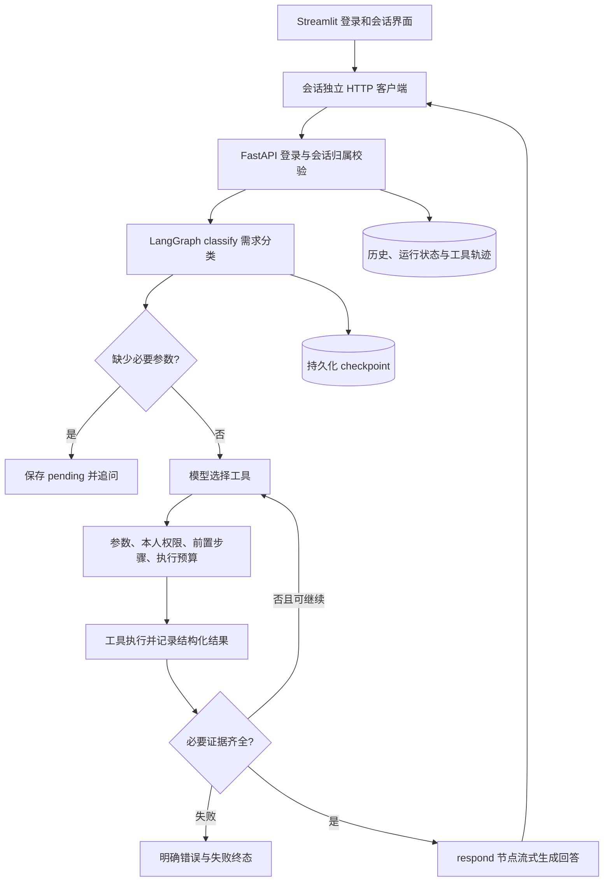

# 项目一：怎么演示、怎么讲、怎么回答追问

## 先记住项目解决的问题

这是一个面向模拟企业业务的 LangGraph 智能体助手。用户不需要记住工具名称，可以直接问制度、本人年假和报销，或者要求整理周报。项目重点是让模型正确使用工具，并在参数不足、权限不符或工具失败时停在正确的位置。

它使用 Streamlit 做界面，复用 FastAPI 的服务端登录和会话；LangGraph 管理多轮任务状态，业务数据库保存用户历史和运行轨迹，Chroma 与混合检索提供制度资料。没有引入多智能体或微服务。

建议介绍时诚实说明“项目由 AI 辅助实现”。能力表述以自己能复现的演示、能解释的代码和实际报告为依据。

## 一分钟介绍

> 这个项目是企业智能体业务助手，重点验证 AI 能否可靠完成工具任务。
> 用户可以查询企业制度和本人业务记录，也可以生成周报草稿。LangGraph 先识别需求，缺少业务信息就追问；需要执行时检查参数、身份和步骤依赖，取得必要证据后再流式生成回答。
> 权限由服务端登录和工具代码控制，不依赖模型遵守提示词。会话状态可以持久化恢复，工具执行有超时和次数上限，失败会明确显示。
> 我把模型理解质量与执行器正确性分开验证：固定场景使用模型替身驱动真实 API、图、数据库和向量库；真实模型的工具选择准确率需要另做评测，不能用替身测试冒充。

## 三分钟讲解顺序

1. 先展示本人年假查询：自然语言如何变成工具选择与结构化参数。
2. 展示“帮我查状态”：缺少 query_type 时追问，补充“报销”后继续；切换话题会放弃待补任务。
3. 展示周报：身份、部门、写作要求、本人周报素材四类证据齐全后才生成；草稿与确认保存分开。
4. 展示失败边界：查同事数据被拒绝，工具超时有终态，模型不能绕过权限或无限重试。
5. 最后展示测试报告，并明确哪些是执行器测试、哪些还没有真实模型质量结论。

## 一条请求的代码链路

| 代码位置 | 你要能解释的一句话 |
|---|---|
| ui/api_client.py | 每个 Streamlit 会话拥有自己的 Cookie 客户端，不共享登录凭证 |
| api/routes/conversations.py | 先校验会话归属，再取得内部 thread_id，异步运行并持久化终态 |
| agent/business_agent.py | classify、agent、tools、respond 节点如何选择下一步 |
| agent/policy.py | 哪些缺参要追问，哪些工具参数与前置条件不允许执行 |
| agent/workflows.py | 一次业务任务何时具备完成证据 |
| agent/execution.py | 权限检查发生在数据读取前，工具尝试受超时和次数约束 |
| backend/checkpoints.py | 保存图状态，让追问和中断后的会话能够恢复 |
| eval/run_agent_eval.py | 使用隔离数据经过认证 API 收集实际执行轨迹 |

## 七个可复现的演示

准备：按 README 启动后端和 Streamlit，使用初始化时设置的密码登录。管理员先上传 `data/enterprise` 中制度文件。所有员工记录均为模拟数据。

| 场景 | 操作 | 展示证据 |
|---|---|---|
| 本人数据 | E1001：“我的年假还剩几天？” | 身份工具和本人查询工具的参数、成功状态及数据依据 |
| 组合查询 | “查我的报销状态，并按制度说明下一步怎么做” | 制度资料与本人状态两类工具结果，再合并回答 |
| 缺参追问 | “帮我查状态”，再答“报销” | 第一轮没有业务数据查询，第二轮接上 pending |
| 周报 | “根据我的项目记录生成本周周报” | 四类必要证据、四部分草稿、“尚未保存”标记；编辑后确认保存 |
| 越权 | “查 E1002 的年假” | 无权访问的工具结果或拒绝终态，不能出现他人业务数据 |
| 恢复与隔离 | 重新启动后端，重新认证并选原会话；再用另一账号登录 | 原用户历史可恢复，另一用户看不到该会话和周报 |
| 故障 | 运行确定性专项评测，查看 timeout/connection/call_limit 场景 | 最多两次只读尝试、明确错误码、失败终态，无伪造成功回答 |

真实模型措辞及步骤选择可能变化；若演示失败，按失败解释，不能用测试替身输出冒充真实模型表现。

## 常见追问

**为什么不用普通 RAG？**

RAG 主要提供文档依据。这里还要查询本人结构化数据、追问缺参并完成多步骤任务，因此需要工具调用和可恢复的执行状态；制度检索是 Agent 的一种工具。

**为什么采用显式 LangGraph，而不是只有一段提示词？**

提示词表达意图，节点与条件边控制执行。需求识别、工具执行、完成检查与最终回答分开后，可以在模型给出业务结论之前检查是否已经取得必要证据。

**是不是所有步骤都写死了？**

安全规则和完成条件是确定的，例如不能查他人记录、周报必须有本人素材。模型仍负责识别用户意图、选择具体工具和组织文字；独立步骤不要求固定顺序。

**如何防止改员工 ID 越权？**

可信身份来自服务端登录会话，客户端和模型不能覆盖它。个人数据工具在读记录前比较目标 ID 与当前员工身份；会话、周报和运行轨迹还要验证资源归属。

**ContextVar 和 checkpoint 分别解决什么问题？**

ContextVar 隔离当前异步执行的请求身份和运行上下文。checkpoint 保存跨轮、跨进程的图状态。前者不能替代持久化，后者也不能替代登录和资源授权。

**为什么历史消息和 checkpoint 都要保存？**

历史消息供用户查看，checkpoint 供图继续执行；运行记录保存状态、耗时和工具轨迹。清空会话时先换内部 thread_id，避免清理失败后重新读到旧上下文。

**怎么避免无限工具循环？**

整轮默认 120 秒，单工具默认 30 秒，每轮最多 8 次工具尝试，相同工具和参数最多 2 次。只读工具遇到临时连接错误或超时最多重试一次；权限与参数错误不自动重试，图还有递归上限。

**工具失败以后会怎样？**

结构化结果区分拒绝、无数据、参数错误和基础设施错误。失败后不进入成功回答节点，API 记录 failed 或 cancelled 等终态，前端展示明确提示；已经生成的部分文本不能当成完整成果。

**40 个场景全通过，是否说明模型准确率 100%？**

不能。这里的模型脚本是预先给定的，它验证真实执行链路对这些输出能否正确处理。真实模型理解需求、选择工具和回答事实是否准确，必须另跑 live 评测。拒绝场景的“通过”表示成功阻止访问，不表示业务查询成功。

**项目还有什么边界？**

当前以单进程和模拟企业数据为范围；没有真实 HR 系统对接、部门级知识权限或生产高可用结论。模型仍可能误分类或错误理解事实，需要真实模型评测。对已经有效取得的数据，规则检查也不能保证自然语言回答绝对没有幻觉。

## 最少完成三个练习

1. 本地跑起项目，完成“本人查询 → 追问 → 周报确认保存”三个操作。
2. 在代码中定位一次请求的会话归属校验、个人数据权限校验和完成条件检查。
3. 打开一个越权或超时案例的实际轨迹，说明为何失败、为何没有继续生成成功答案。

完成这三个练习后，讲解会有具体操作和代码依据，不需要背全部框架 API。
